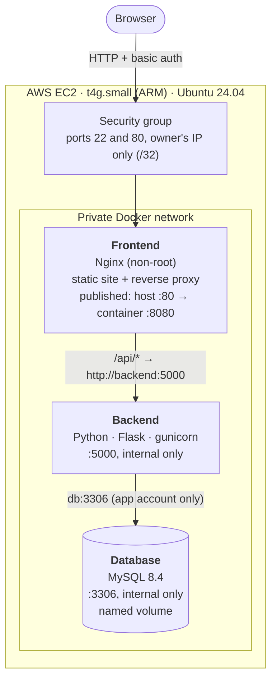

# Three-Tier Notes App: Docker Compose on AWS EC2

A three-tier web application (**Nginx → Python API → MySQL**), containerized with Docker Compose, hardened for production-style operation, and deployed to an **AWS EC2** server provisioned with **Terraform**.

The application is deliberately simple (create, list and delete notes). The focus is the engineering around it: **network isolation, secrets handling, health-checked startup, least privilege, automatic recovery, infrastructure as code, and automated end-to-end testing**.

**Verified:** the same smoke test passes **10/10 locally, on the server, and across the internet**, and the full stack **recovers by itself after a server reboot**.

---

## Architecture



| Tier | Image | Port | Reachable from |
|---|---|---|---|
| Frontend | Custom, on `nginxinc/nginx-unprivileged:1.27-alpine` | Host 80 → container 8080 | **Owner's IP only** (security group) |
| Backend | Custom, on `python:3.12-slim` | 5000 | **Frontend only** (private network) |
| Database | Official `mysql:8.4` | 3306 | **Backend only** (private network) |

**Only one port is ever exposed: 80.** The backend and database have no published ports, and the security group never opens 3306, so the database is protected by two independent layers.

### How a request flows

1. The browser requests `/`: Nginx serves `index.html`, `app.js` and `styles.css`.
2. The page calls `fetch("/api/notes")`, a **relative** path, so it goes back to Nginx (same origin, **no CORS** needed).
3. Nginx's `location /api/` **reverse-proxies** the request to `http://backend:5000`, resolved by Docker's internal DNS.
4. The backend validates the request and queries MySQL at `db:3306` using parameterized SQL.
5. The frontend translates every status code into a plain-language message for the user.

---

## Tech stack

| Area | Technology |
|---|---|
| Frontend | HTML, CSS, vanilla JavaScript; **Nginx** (unprivileged) as web server and reverse proxy |
| Backend | **Python 3.12**, Flask, PyMySQL, gunicorn |
| Database | **MySQL 8.4** (LTS) |
| Containers | **Docker**, **Docker Compose** |
| Cloud | **AWS EC2** (Graviton `t4g.small`), security groups, EBS (encrypted gp3) |
| Infrastructure as code | **Terraform** (AWS provider 6.x) |
| Server bootstrap | **cloud-init** user data |
| Testing | Bash **smoke test**, run locally, on the server, and remotely |

---

## Key design decisions

### Networking

- **Nginx as the single entry point (reverse proxy).** One public port; the backend and database are invisible from outside. Serving the page and the API from the same origin removes CORS entirely.
- **Services connect by name, never `127.0.0.1`.** Inside a container, `127.0.0.1` means *that container itself*. The backend reaches MySQL at `db`, and Nginx reaches the backend at `backend`, through Docker's DNS.
- **gunicorn binds `0.0.0.0`, not `127.0.0.1`.** Binding to loopback would make the backend unreachable from the Nginx container (verified experimentally).
- **Nginx re-resolves the backend every 10 seconds** (`resolver 127.0.0.11 valid=10s` with a variable `proxy_pass`). By default Nginx resolves upstream names once at startup, which causes **502 errors after the backend is rebuilt** with a new IP.

### Reliable startup

- **Health-check-gated startup order:** `db` → `backend` → `frontend`, using `depends_on: condition: service_healthy`. Each tier starts only when the one below is genuinely *ready*, not just *started*.
- **MySQL's health check pings `127.0.0.1`, deliberately not `localhost`.** On first start, MySQL runs a temporary server with **networking disabled** (`port: 0` in the logs) while it runs `init.sql`. `localhost` uses the Unix socket, which would report healthy *during* initialization; a TCP ping to `127.0.0.1` only succeeds once the real server is up.
- **The backend's health check also tests the database** (`SELECT 1`), returning **503** when the database is unreachable. "Running" isn't the same as "working".

### Security

- **Least privilege in the database:** the application uses a dedicated `notes_app` account with rights on `notesdb` only. The root password is **never given to the backend container**: Compose passes it only the four values it needs, instead of the whole `.env` file.
- **Secrets never in Git or images:** `.env` and the Nginx password file are git-ignored. The password file is **mounted at runtime**, never baked into an image. Each environment generates its **own** secrets (the server's were generated on the server with `openssl rand`, never displayed).
- **Non-root containers:** the backend runs as `appuser` (uid 10001); Nginx uses the official **unprivileged** image (uid 101), listening on 8080 because ports below 1024 require root.
- **Reduced kernel privileges:** `cap_drop: [ALL]` and `no-new-privileges` on the frontend and backend. (Not applied to MySQL, which needs a few capabilities during startup.)
- **SQL injection prevented** with parameterized queries (`%s` placeholders); verified by storing `'); DROP TABLE notes; --` as harmless text.
- **XSS prevented** by rendering all user data with `textContent`, plus a strict **Content-Security-Policy** (no inline scripts); verified with an `` payload.
- **Security headers:** CSP, `X-Frame-Options: DENY`, `X-Content-Type-Options: nosniff`, `Referrer-Policy`; Nginx version hidden.
- **Basic authentication** on the whole site (health endpoint excluded so Docker can check it), combined with a **security group restricted to a single IP**: defense in depth.
- **EC2 hardening:** IMDSv2 required (mitigates SSRF credential theft), encrypted root volume, **no IAM role** (the server needs no AWS permissions), and a Terraform **validation rule** that rejects anything other than a single `/32` address.
- **Read-only deploy key:** the server can read this one repository and nothing else.

### Operations

- **Restart policies** (`unless-stopped`) plus **Docker enabled at boot**, so the whole stack returns after crashes and reboots.
- **Resource limits sized from measurements** (see Results): 768 MB for MySQL, 256 MB for the backend, 64 MB for Nginx, which together fit a 2 GB instance with headroom.
- **Log rotation** (10 MB × 3 files per container), so logs can never fill the disk.
- **Instance type chosen from data:** measured usage (~531 MB) ruled out a 1 GB instance. **ARM (Graviton)** matches the development machine (Apple Silicon), so images behave identically.
- **Robust server bootstrap:** network steps in cloud-init are **retried**, after a real first-boot failure (see Problems solved).

---

## Repository structure

```
.
├── docker-compose.yml        All three services, network, volume, limits, health checks
├── .env.example              Template of required settings (real .env is git-ignored)
├── db/
│   └── init.sql              Creates the notes table + sample data on first start
├── backend/
│   ├── Dockerfile            python:3.12-slim, layer-cached deps, non-root user
│   ├── requirements.txt
│   └── app.py                Flask API: health, list, create, delete
├── frontend/
│   ├── Dockerfile            Unprivileged Nginx + config + site
│   ├── nginx.conf            Static files, reverse proxy, auth, security headers
│   └── html/                 index.html, app.js, styles.css
├── infra/                    Terraform: EC2, security group, key pair, user data
│   ├── main.tf  variables.tf  outputs.tf  versions.tf
│   ├── user-data.sh          Installs Docker at first boot (with retries)
│   └── terraform.tfvars.example
└── scripts/
    ├── smoke-test.sh         End-to-end test (10 checks), local or remote
    └── deploy.sh             Server-side deploy: pull, rebuild changed services, prune
```

---

## API

| Method | Path | Purpose | Success |
|---|---|---|---|
| `GET` | `/api/health` | Backend up **and** database reachable | 200 (503 if the DB is down) |
| `GET` | `/api/notes` | List notes, newest first (max 100) | 200 |
| `POST` | `/api/notes` | Create a note (`title` 1–200, `content` 1–5000 chars) | 201 |
| `DELETE` | `/api/notes/{id}` | Delete a note | 204 (404 if not found) |

All database errors return **503**, so clients know to retry; unexpected errors return a generic **500**, with details only in the logs.

---

## Run it locally

**Prerequisites:** Docker Desktop (Compose v2).

```bash
git clone https://github.com/zeel09062001/three-tier-docker-compose.git && cd three-tier-docker-compose

# 1. Settings: copy the template and set strong passwords
cp .env.example .env            # then edit the two "change-me" passwords

# 2. Website password file (username: admin); the password is typed silently
echo -n "Password: "; read -s PW; echo
printf '%s' "$PW" | docker run --rm -i httpd:2.4-alpine htpasswd -nim admin > frontend/htpasswd
unset PW

# 3. Build and start; --wait returns only when every service is healthy
docker compose up -d --build --wait

# 4. Open http://localhost (log in as admin), or run the smoke test:
export SMOKE_AUTH="admin:<your password>"
./scripts/smoke-test.sh
```

---

## Deploy to AWS

**Prerequisites:** AWS CLI configured, Terraform ≥ 1.10, an SSH key at `~/.ssh/three-tier-notes`.

```bash
# 1. Infrastructure
cd infra
cp terraform.tfvars.example terraform.tfvars   # set my_ip_cidr to "$(curl -s https://checkip.amazonaws.com)/32"
terraform init && terraform apply

# 2. On the server (cloud-init has installed Docker)
$(terraform output -raw ssh_command)
cloud-init status --wait
#    - add a read-only deploy key for this repository, then git clone it
#    - create .env from .env.example with generated passwords, and PUBLIC_BIND_ADDRESS=0.0.0.0
#    - create frontend/htpasswd as above
docker compose up -d --build --wait

# 3. Verify from your own machine
./scripts/smoke-test.sh "http://$(terraform output -raw public_ip)"
```

**Deploying updates:** commit and push from the development machine, then on the server run `./scripts/deploy.sh` (pulls with `--ff-only`, rebuilds only changed services, waits for health, prunes old images). Code is **never edited on the server**.

---

## Testing

`scripts/smoke-test.sh` verifies the whole chain in seconds and returns a proper **exit code** (0 = pass, 1 = fail), so it can gate a CI/CD pipeline. It cleans up after itself.

| # | Check |
|---|---|
| 0 | Requests **without** a password are refused (401) |
| 1 | Nginx serves the web page |
| 2 | Nginx's own health endpoint returns 200 (no auth) |
| 3 | `/api/health` through Nginx reports the database reachable (all three tiers) |
| 4 | Creating a note returns 201 (a real database write) |
| 5 | The new note appears in the list (a real read) |
| 6 | Deleting it returns 204 |
| 7 | Deleting it again returns 404 |
| 8 | Invalid input returns 400 |
| 9 | Security headers are present |

**The test was also proven to fail correctly:** with the database stopped, the frontend checks pass and every database-dependent check fails with a clear reason, pinpointing the broken tier.

Other verified behaviours: data survives `docker compose down` / `up` (named volume); the backend **recovers automatically** when the database returns; a crashed backend is **restarted by Docker**; the containers run as non-root with capabilities dropped; port 3306 is unreachable from outside the server.

---

## Results

| Measurement | Result |
|---|---|
| Smoke test, local | **10 / 10** |
| Smoke test, on the EC2 server | **10 / 10** |
| Smoke test, from the internet to EC2 | **10 / 10** |
| Server reboot (`sudo reboot`) | All services returned **healthy automatically**, data intact |
| Startup order (from timestamped logs) | MySQL temporary server (`port: 0`) → real MySQL (`port: 3306`, +2 s) → backend (+5 s) → frontend (+5 s) |
| Local start from empty volume (build cache warm) | **19.2 s** to all services healthy |
| Memory in use | MySQL **463.5 MB** · backend **58.8 MB** · Nginx **8.6 MB** (~531 MB total) |
| Image sizes | Frontend **76 MB** · backend **213 MB** · MySQL **1.11 GB** |
| Instance | `t4g.small` (2 vCPU, 2 GB, ARM), chosen from the memory measurements |

---

## Problems solved

**1. A database outage showed users a generic error.** Testing the real user actions (not just the health check) revealed that list/create/delete returned **500** when MySQL was down, because only `/api/health` caught database errors. **Fix:** a single Flask error handler for `pymysql.MySQLError` returning **503** across all routes. *Lesson: test the paths users actually take.*

**2. MySQL could report "healthy" before it was ready.** Timestamped logs showed MySQL's two-stage first start: a temporary server with networking off (`port: 0`), then the real one (`port: 3306`). **Fix:** health check over TCP (`127.0.0.1`) instead of the socket (`localhost`), so "healthy" means initialization has finished.

**3. Rebuilding the backend could break the site with 502s.** Nginx caches upstream IPs at startup, and a recreated container can get a new IP. **Fix:** Docker's DNS resolver with a 10-second validity and a variable `proxy_pass`. Verified by recreating the backend while Nginx kept running.

**4. The first EC2 server came up without Docker.** cloud-init's log showed `apt-get update` failed on first boot (a temporary mirror/network issue), and `set -e` correctly stopped the script. **Fix:** retry network operations in `user-data.sh`, then **replace** the server with Terraform rather than repairing it by hand, so the fix lives in code.

**5. Timestamps displayed hours off.** MySQL returns UTC times without a timezone marker, so browsers interpreted them as local time. **Fix:** treat API timestamps as UTC on the client and convert for display.

---

## Known limitations

These are deliberate trade-offs for a learning project, documented rather than hidden:

- **HTTP, not HTTPS.** Basic-auth credentials are encoded, not encrypted, in transit. Mitigated by restricting the security group to a single IP.
- **Single server.** One EC2 instance is a single point of failure; there is no failover.
- **Database in a container on one disk.** No automated backups or point-in-time recovery.
- **Manual deployment** via `deploy.sh`; no CI/CD pipeline yet.
- **SSH port open** (to one IP) for administration.
- **One shared login.** No per-user accounts; every authenticated user sees all notes.
- **Local Terraform state**, suitable for one person but not a team.

---

## Future enhancements

In priority order, with the reasoning behind each:

| # | Enhancement | Why |
|---|---|---|
| 1 | **HTTPS** with a domain and a free certificate (Let's Encrypt, or an Application Load Balancer with ACM) | Encrypts all traffic, including credentials; allows the site to be opened beyond one IP |
| 2 | **Amazon RDS for MySQL** instead of the database container | Managed automated backups, point-in-time recovery, Multi-AZ failover and patching; removes the single disk as a point of data loss |
| 3 | **CI/CD with GitHub Actions**: build, scan with Trivy, push to ECR, deploy, then run the smoke test as a gate | Every change tested and deployed the same way; vulnerable images blocked |
| 4 | **AWS Systems Manager Session Manager** instead of SSH | No open SSH port and no keys to manage; every session logged |
| 5 | **Backups** (until RDS): scheduled `mysqldump` to an encrypted, versioned S3 bucket, plus a tested restore | Data recovery today depends on one EBS volume |
| 6 | **Monitoring**: container logs to CloudWatch, alarms on health and resources, an external uptime check | Know about failures before users report them |
| 7 | **Real user accounts** (e.g. Amazon Cognito) with per-user notes | Replace the shared basic-auth login; authorization per user |
| 8 | **Secrets in AWS Secrets Manager** | Central storage and automatic rotation instead of a `.env` file on disk |
| 9 | **Supply-chain hardening**: pin images by digest, multi-stage builds, read-only root filesystems, a Python lock file | Reproducible, smaller, harder-to-tamper images |
| 10 | **Migrate to Kubernetes (EKS)** | Self-healing of *unhealthy* (not just stopped) containers, scaling, rolling updates |
| 11 | **Remote Terraform state** (S3 with locking) and a VPC with private subnets | Team-ready infrastructure; database tier in a private subnet |
| 12 | **Connection pooling and pagination** in the backend | Efficiency under load and for large datasets |

### From Compose to Kubernetes

Every concept here has a direct Kubernetes equivalent, which makes item 10 a natural next step:

| Docker Compose (this project) | Kubernetes |
|---|---|
| Service name resolution (`db`, `backend`) | **Service** + CoreDNS |
| Nginx reverse proxy, one public port | **Ingress** / **Gateway API** |
| Health checks + `depends_on` | **Readiness probes**, init containers |
| `restart: unless-stopped` | **Deployments** + **liveness probes** (also restart *unhealthy* containers) |
| `deploy.resources.limits` | `resources.limits` |
| `cap_drop`, non-root users | `securityContext` |
| `.env`, mounted `htpasswd` | **ConfigMaps** and **Secrets** |
| Named volume | **PersistentVolumeClaim** |

---

## Cost and teardown

Approximate `us-east-1` costs: `t4g.small` about $0.017/hour (~$12/month if always on), public IPv4 ~$3.60/month while running, 20 GB gp3 ~$1.60/month. The instance is **stopped when not in use**, and everything is removed with:

```bash
cd infra && terraform destroy
```

---

## Skills demonstrated

**Docker & Compose** (custom images, layer caching, networks, volumes, health checks, startup ordering, restart policies, resource limits, log rotation) · **Nginx** (reverse proxy, DNS re-resolution, security headers, basic auth) · **Linux & networking** (loopback vs all-interfaces binding, ports, DNS, capabilities, SSH keys) · **MySQL** (initialization, least-privilege accounts, persistence) · **Python** (REST API, parameterized SQL, error handling) · **AWS** (EC2, Graviton, security groups, IMDSv2, EBS encryption, cost control) · **Terraform** (variables with validation, data sources, outputs, replacement on change) · **Security** (defense in depth, secrets management, injection/XSS prevention) · **Testing & operations** (automated smoke tests with exit codes, failure testing, reboot recovery, repeatable deployments, root-cause debugging).